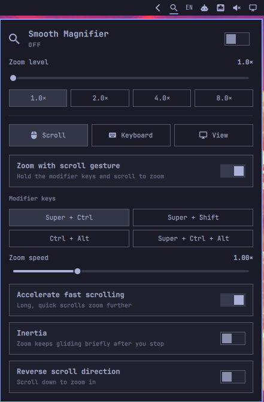

# Smooth Magnifier

Smooth, macOS-style screen zoom for [Omarchy](https://omarchy.org). Hold
Super + Ctrl and scroll to zoom. The picture glides between zoom levels
instead of stepping, and zoom-chord scrolls no longer reach the window under
the pointer, so browsers don't zoom the page and terminals don't resize their
font.

A bar icon shows the zoom level. Click it to open the settings panel,
right-click it to toggle zoom, middle-click it to reset, or scroll on it to
zoom.



## Features

- **Smooth zoom.** Scroll input is batched every 16 ms and zoom is stepped in
  log space, so each notch scales by the same ratio at any level. Hyprland's
  frame-synced `zoomFactor` animation glides to each new target.
- **No scroll leaking.** Every zoom-chord wheel event is consumed. See
  [How it works](#how-it-works).
- **Scroll settings:** four modifier presets (Super + Ctrl, Super + Shift,
  Ctrl + Alt, Super + Ctrl + Alt), speed, acceleration, inertia, and reverse
  direction.
- **macOS-style keyboard shortcuts**, plus hold-to-toggle.
- **The three macOS tracking modes**, under Advanced: continuously with the
  pointer (default), only when the pointer reaches an edge, or keep the
  pointer centered.
- **View settings:** smooth images (antialiasing), animation smoothness, the
  zoom level used when toggling on, maximum zoom, and restoring the zoom
  level at login.
- Follows the Omarchy theme. All text is in a translation catalog
  (`i18n/en.json`).

## Requirements

- Omarchy (Quattro) with Hyprland 0.56 or newer and its Lua config
  (`~/.config/hypr/hyprland.lua`).
- Nothing else at runtime. The plugin uses `hyprctl` (part of Hyprland) and
  the shell's own Quickshell. No network access, no sudo, no services.
- For development only: `lua` and `node`, to run the tests.

## Install

```bash
omarchy plugin add https://github.com/develroads/magnifier.git --enable
```

That's it. No Hyprland config file is edited. The plugin loads its zoom engine
into Hyprland's running Lua state (`hyprctl repl`) as soon as the bar
starts. Hyprland starts its Lua state afresh on every config reload, so the
plugin loads the engine again the moment Hyprland reports the reload,
usually within a few hundredths of a second. Your zoom level is kept.

## Remove

```bash
omarchy plugin remove io.github.develroads.smooth-magnifier
hyprctl reload
```

The reload clears the engine from Hyprland at once; otherwise it stays until
the next reload or login. Nothing is left in your config. Saved settings live
in `~/.local/state/smooth-magnifier/`; delete that folder for a clean slate.

## Shortcuts

| Action | Keys |
|---|---|
| Zoom | modifier (default Super + Ctrl) + scroll |
| Toggle zoom | Super + Alt + 8 |
| Zoom in / out | Super + Alt + = / Super + Alt + - |
| Toggle smooth images | Super + Alt + \ |
| Hold to toggle | Super + Alt + Z (held) |
| Zoom in a step | Super + Ctrl + Z |
| Reset zoom | Super + Ctrl + Alt + Z |

IPC: `omarchy-shell smooth-magnifier toggleZoom | zoomIn | zoomOut | resetZoom | showPage scroll|keyboard|view`

## How it works

- `hypr/magnifier.lua` is the engine. It runs inside Hyprland and owns the
  zoom binds, the zoom animation curve, and the settings
  (`~/.local/state/smooth-magnifier/settings.lua`, loaded as data only).
- `Panel.qml` is the bar widget and panel. It talks to the engine through
  `hyprctl repl`. `Model.js` builds those calls from a fixed whitelist of
  setting keys and checked values, and validates every reply.
- Loading: every call the panel makes starts with "load the engine if
  Hyprland doesn't have it" (`pcall(dofile, <plugin>/hypr/magnifier.lua)`).
  The panel also makes a call whenever Hyprland emits `configreloaded`. On
  load, the engine puts your zoom back instantly. Within a session the level
  comes from `$XDG_RUNTIME_DIR/smooth-magnifier-zoom`; at a new login it is
  restored only if that setting is on.
- The engine runs while the widget is in your bar. If you take the widget out
  of the bar, the engine stays until the next config reload or login, then it
  is gone.
- After a config reload, while you are zoomed in, the screen is at 1x for the
  moment it takes Hyprland to report the reload (typically under 50 ms).

**Changes to Hyprland's behaviour.** Be aware of these before installing:

- Hyprland's `binds:scroll_event_delay` (300 ms by default) fires a wheel bind
  at most once per delay and passes the remaining wheel events to the window
  under the pointer, with the modifiers still held. That is what made other
  zoom setups resize browser and terminal text. The engine sets the delay to
  0.
- So that Omarchy's own Super + scroll (workspaces) and Super + Alt + scroll
  (window groups) keep their pace, the engine re-binds those with the same
  rate limit. It also routes Omarchy's Super + Ctrl + Z and
  Super + Ctrl + Alt + Z zoom keys through the smooth engine. If you set
  `omarchy_default_bindings = false`, none of these Omarchy binds are
  touched.
- Wheel binds you add yourself are not rate limited while the engine is
  loaded.

**Not included.** Hyprland only offers full-screen zoom, and its zoom camera
can't be steered from outside. Split-screen and picture-in-picture zoom,
"zoom follows keyboard focus", and "speak items under pointer" are therefore
not available.

## Development

```bash
git clone https://github.com/develroads/magnifier.git ~/Code/develroads/magnifier
ln -s ~/Code/develroads/magnifier ~/.config/omarchy/plugins/io.github.develroads.smooth-magnifier
omarchy plugin enable io.github.develroads.smooth-magnifier

lua tests/engine_test.lua    # engine, against a stubbed Hyprland API
node tests/model_test.js     # panel helpers, including injection cases
```

Changes to `Panel.qml` take effect after `omarchy restart shell`. The engine
reloads whenever Hyprland reloads its config (for example `hyprctl reload`).

## License

[MIT](LICENSE) © 2026 develroads
